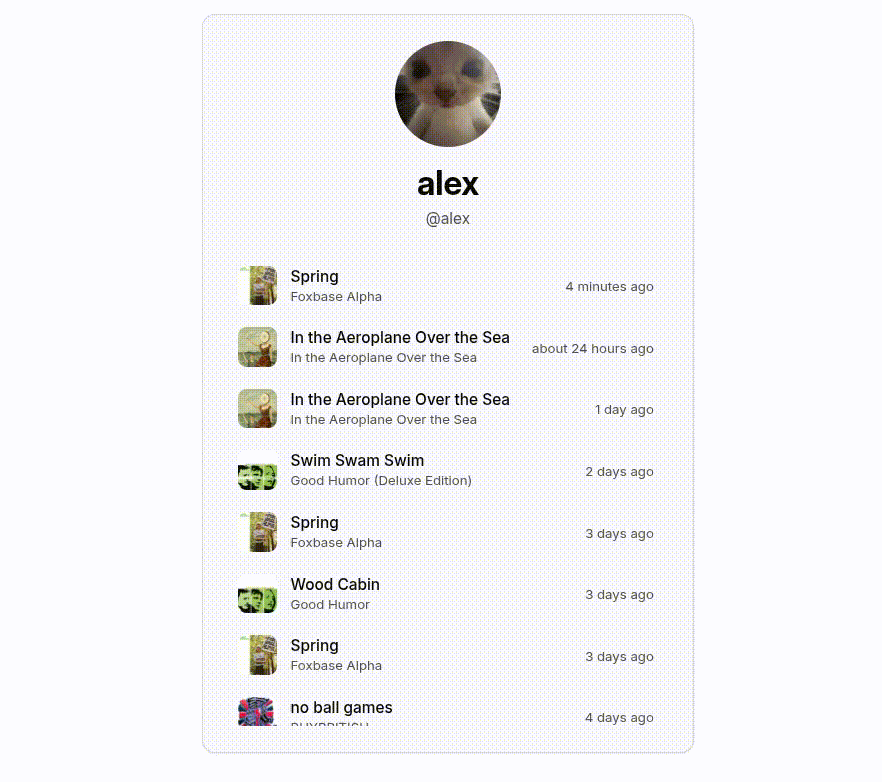

# my.fm

my.fm is a small, self-hosted [last.fm](https://last.fm) clone. It connects to
your Spotify account and keeps a history of the tracks you play.

## Architecture

- The app (`app/`) is a simple React served over a Cloudflare Worker
- The API (`api/`) is an Effect + `effect/http-api` application also on
  Cloudflare Workers. It fetches users' recently played tracks on a schedule
  through a cron trigger and stores them in D1.

Both components are deployed with [Alchemy](https://alchemy.run).

## Listening charts

`GET /api/stats/getTop?username=alex&kind=artists&period=week` returns the
most-played artists over the trailing seven days. The MCP equivalent is
`get_top({ kind: "artists", period: "week" })` for the signed-in listener.
Use `getSummary` or `get_summary` for the top five artists, albums and tracks together.

Both accept `today`, `week`, `month`, `sixMonths`, `year`, and `all` (the default).
The rolling periods span 7, 30, 180 and 365 days respectively. `today` starts at
local midnight in the optional `timeZone` (UTC by default).

Period charts can lag new plays or imports by up to 15 minutes. For an exact
range, omit `period` and pass `since` and/or `until` as Unix seconds instead;
these requests bypass the cache. `since` is inclusive and `until` is exclusive.

## Development

You need [Bun](https://bun.sh) and a [Spotify
application](https://developer.spotify.com/). [Caddy](https://caddyserver.com/)
is optional: it serves the app over HTTPS on a local domain.

Linting requires Node.js 22.18+ on the 22.x line or Node.js 24+.

The Spotify app needs a redirect URI that matches the origin you use in
development. With the Caddy proxy below, that is
`https://my.fm/api/auth/callback/spotify`.

```sh
cp .env.example .env # then fill in the Spotify credentials
bun install
bun run dev
```

To use the Caddy proxy:

```sh
bun run dev:proxy
```

Add an entry to your `/etc/hosts` such as:

```
127.0.0.1		my.fm
```

You can go to <https://my.fm>.

### Commands

Useful commands:

- `bun run dev` starts the app, the API, and a local database.
- `bun run dev:proxy` serves the app over HTTPS with Caddy.
- `bun run deploy` creates or updates this stage's Cloudflare resources.
- `bun run deploy:preview` deploys the `preview` stage.
- `bun run destroy` removes this stage's Cloudflare resources.
- `bun run destroy:preview` removes the `preview` stage.
- `bun run test` runs the test suites.
- `bun run lint` and `bun run fmt` check and format the code.
- `bun run typecheck` typechecks the packages.
- `bun run typecheck:infra` typechecks the root Alchemy stack.
- Write handwritten SQL migrations under `api/migrations/<timestamp>_<name>/migration.sql`;
  existing migration files are immutable.

## Demo

Here is what it looks like:


