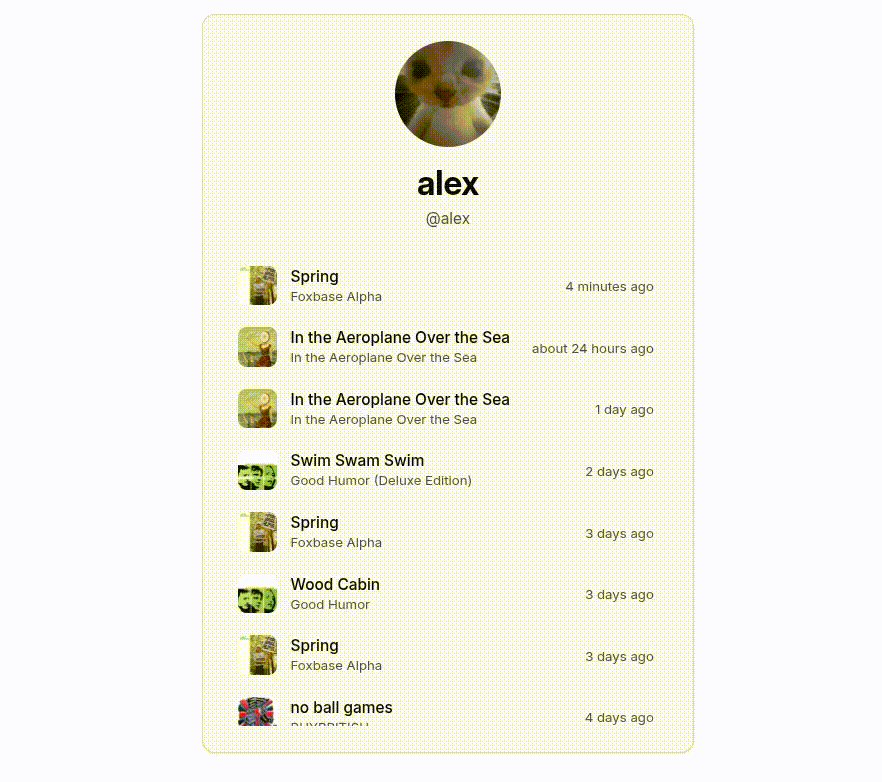

# my.fm

my.fm is a little [last.fm](https://last.fm) clone. It can be trivially self
hosted and can support an unknown amount of users (I'm not sure how many, it
may get rate limited by Spotify after a certain number of users)

## Stack

On the frontend, my.fm uses [React 19](https://react.dev). For the design
system, [Tailwind](https://tailwindcss.com) with [9ui](https://www.9ui.dev/)
components (which in turn use [Base UI](https://base-ui.com/)) is used. For
routing, we use [React Router](https://reactrouter.com). The app is a
single-page build served from a Cloudflare Worker.

On the backend, a [Hono](https://hono.dev) API runs on Cloudflare Workers and
uses D1 through [Drizzle](https://orm.drizzle.team/). Authentication is
offloaded to [Better Auth](https://better-auth.com). A Cron Trigger fetches
Spotify plays every minute. [Alchemy](https://alchemy.run) deploys the app, the
API, the database, and the cron trigger in one stack.

## Development

```sh
cp .env.example .env   # then fill in the Spotify credentials
bun install
bun run dev            # prints the app and API URLs
```

The root `.env` only holds the Spotify client ID and secret. Better Auth
derives its URLs and the Spotify callback from each request, so there are no
origin or redirect values to configure. Alchemy generates the Better Auth
signing secret on the first deploy and stores it in the Cloudflare state store
configured by `Cloudflare.state()`. `.alchemy` is only a local working
directory, not the authoritative store.

`bun run dev` runs `alchemy dev` from the repository root and prints both
local URLs. Open the app URL it prints. The app Worker forwards the API paths
to the API Worker; in development, Vite proxies the same shared path list to
the local API Worker.

- `bun run deploy` creates or updates the Cloudflare resources.
- `bun run destroy` removes this stage's resources.
- `bun run typecheck:infra` typechecks the root stack.

Register `<app origin>/api/auth/callback/spotify` in the Spotify application
for each origin you use. The deployed app has no URL settings to fill in after
its first deploy.

The Bun implementation in `api/` remains in the repository and is independent
of the deployed app.

## Cloudflare migration

`worker-api/` contains the Cloudflare Workers port of the API, and
`MIGRATION.md` records the migration plan and its decisions. The web app is
deployed from the same root `alchemy.run.ts` stack; see the
[worker-api README](./worker-api/README.md) for the API-specific details.

## Demo

(I'll set up a hosted instance of it soon)

Here's what it looks like!


